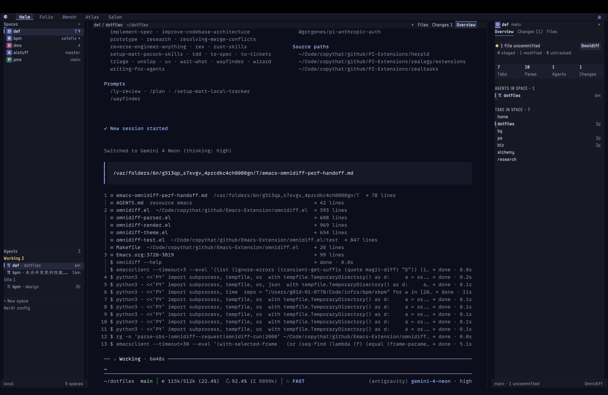

# herdr-sanctum

A native Emacs multi-agent workbench UI for [Herdr](https://github.com/herdr-dev/herdr), built around a three-pane layout.



- **Left sidebar (`*sanctum-spaces*`)**: unified top header bar (`Spaces` + `+`), flat Herdr spaces with inline SVG monograms, combined async Git ahead/behind/dirty indicators, focused-space auto-expanding tab tree (`'focused` default, manual toggle on any space), and a compact **Agents** section flowing directly beneath Spaces grouped by `Blocked` / `Working` / `Done` / `Idle` with brand icons and elapsed durations.
- **Center terminal (`*sanctum*`)**: hosts `herdr` through a pluggable terminal backend (shipping with `ghostel`), sharing the unified top header-line with breadcrumbs and auto-converging right-side controls (view pills when the drawer is closed, collapsing to a single `Hide` button while open).
- **Right context drawer (`*sanctum-drawer*`)**: compact toggleable panel (`32`-column default) with unified top header-line and `tab-line` view tabs, backed by a declarative view registry shipping with **Overview** (Git status card with `+N -M` diffstat, compact `Tabs / Panes / Agents / Changes` workspace statistics card, workspace context, automatic shallow sub-repository aggregation for multi-repo workspaces, and changed-file preview), **Changes**, and **Files** views.
- **Seamless navigation & focus**: move across Herdr panes and adjacent Emacs side windows with the same directional commands, fuzzy-jump across attention agents and tabs (`herdr-sanctum-jump`), and see a quiet global attention badge (`◆N ✓N`) whenever the sidebar is hidden.

## Requirements

- Emacs 30.1 or later
- [`herdr`](https://github.com/herdr-dev/herdr) in `exec-path`
- A terminal emulator backend (built-in default: [`ghostel`](https://github.com/dalanicolai/ghostel), or register your own via `herdr-sanctum-register-terminal-backend`)
- Optional: `magit`, `nerd-icons`, `modus-themes` / `ef-themes` (all soft dependencies with built-in fallbacks)

## Installation

### `use-package` + `package-vc` (Emacs 30.1+)

```elisp
(use-package herdr-sanctum
  :vc (:url "https://github.com/oatiz/herdr-sanctum")
  :bind (("C-c h" . herdr-sanctum)
         ("C-c H" . herdr-sanctum-sidebar-toggle)
         ("C-c D" . herdr-sanctum-drawer-toggle)
         ("C-c J" . herdr-sanctum-jump)))
```

Or bind the opt-in prefix keymap:

```elisp
(keymap-global-set "C-c s" herdr-sanctum-command-map)
```

### Recommended `~/.config/herdr/config.toml`

To avoid duplicate sidebars or tab bars inside Emacs, hide Herdr's built-in chrome and inherit the terminal palette:

```toml
[theme]
name = "terminal"

[ui]
sidebar_start_collapsed = true
sidebar_collapsed_mode = "hidden"
hide_tab_bar = true
pane_outer_borders = false
redraw_on_focus_gained = false
```

Run `M-x herdr-sanctum-doctor` inside Emacs to verify your setup.

## Commands & Navigation

All navigation and layout commands operate on Herdr panes/tabs while inside `*sanctum*` and fall back seamlessly to Emacs windows/tabs elsewhere:

- **Directional navigation**: `herdr-sanctum-nav-left`, `herdr-sanctum-nav-down`, `herdr-sanctum-nav-up`, `herdr-sanctum-nav-right` (crosses from Herdr edge panes into adjacent Emacs side windows).
- **Splits, zoom & close (DWIM)**: `herdr-sanctum-split-right`, `herdr-sanctum-split-down`, `herdr-sanctum-zoom-or-maximize`, `herdr-sanctum-close-dwim`.
- **Tabs & agents**: `herdr-sanctum-prev-tab`, `herdr-sanctum-next-tab`, `herdr-sanctum-new-tab-dwim`, `herdr-sanctum-prev-agent`, `herdr-sanctum-next-agent`.
- **Workbench & diagnostics**: `herdr-sanctum`, `herdr-sanctum-sidebar-toggle`, `herdr-sanctum-drawer-toggle`, `herdr-sanctum-jump`, `herdr-sanctum-refresh-state`, `herdr-sanctum-apply-theme`, `herdr-sanctum-doctor`.
- **Prefix keymap (`herdr-sanctum-command-map`)**: `s` open/toggle, `b` sidebar, `d` drawer, `j` jump, `n`/`p` next/prev agent, `t` new tab, `g` refresh, `?` doctor.

## Customization & Extensibility

### Layout & Host Container

- `herdr-sanctum-display-mode`: `'tab` (default dedicated `tab-bar` tab), `'current`, `'frame`, or a custom zero-argument function (e.g. for `tabspaces` / `activities` / `persp-mode`).
- `herdr-sanctum-sidebar-side`, `herdr-sanctum-sidebar-width`, `herdr-sanctum-sidebar-default-open`, `herdr-sanctum-sidebar-sections` (default `'(spaces agents)`), `herdr-sanctum-sidebar-default-expand` (default `'focused`).
- `herdr-sanctum-drawer-side`, `herdr-sanctum-drawer-width` (default `32`), `herdr-sanctum-drawer-default-open`, `herdr-sanctum-drawer-enabled-views`.
- `herdr-sanctum-panel-fringe-width` (default `10` px symmetric graphical fringe padding on side panels), `herdr-sanctum-header-line-enable`, `herdr-sanctum-status-badge-enable`.
- Multi-repo Git discovery (when a workspace directory is not itself a Git repo): `herdr-sanctum-git-subrepo-max-depth` (default `1`, set to `0` to disable), `herdr-sanctum-git-subrepo-max-count` (default `12`), `herdr-sanctum-git-subrepo-exclude-dirs` (default `'("~/" "/")`).

### Pluggable Terminal Backends

`herdr-sanctum` does not hardcode a single terminal emulator. Register any backend with `herdr-sanctum-register-terminal-backend`:

```elisp
(herdr-sanctum-register-terminal-backend
 'my-term
 :start (lambda (buffer program args) ...)
 :live-p (lambda (buffer) ...)
 :setup (lambda (buffer) ...)         ; optional
 :resize (lambda (window) ...)        ; optional
 :mode-banner (lambda (buffer) ...))  ; optional

(setq herdr-sanctum-terminal-backend 'my-term)
```

### Custom Drawer Views

Add your own view to both `*sanctum-drawer*` and `*sanctum*`'s top header bar:

```elisp
(herdr-sanctum-register-drawer-view
 'notes
 :label "Notes"
 :render-fn (lambda (ctx)
              (insert "Project dir: " (or (plist-get ctx :dir) "none") "\n"))
 :action-fn (lambda (action value) ...))

(add-to-list 'herdr-sanctum-drawer-enabled-views 'notes t)
```

### Theme, Icons & External Actions

- Adapts automatically to `modus-themes`, `ef-themes`, and arbitrary light/dark Emacs themes via `herdr-sanctum-palette-function`; run `M-x herdr-sanctum-apply-theme` interactively to force-reapply Sanctum chrome faces after custom palette tweaks.
- `herdr-sanctum-agent-icon-style`: `'svg-files` (bundled icons in `assets/agents/` with automatic 1-letter SVG monogram fallback) or `'unicode`.
- `herdr-sanctum-open-file-function`, `herdr-sanctum-diff-function`, `herdr-sanctum-git-status-function`, `herdr-sanctum-project-find-file-function`, `herdr-sanctum-open-outside-function`.

### Public Event Hooks

Build notifications, automation, or custom status indicators on top of the socket bridge:

- `herdr-sanctum-snapshot-hook` `(snapshot)`
- `herdr-sanctum-focus-change-hook` `(dir pane-id workspace-id tab-id)`
- `herdr-sanctum-agent-status-change-hook` `(agent old-status new-status)`
- `herdr-sanctum-event-hook` `(kind data)`
- `herdr-sanctum-disconnect-hook` `()`

## Optional Companion Modules

### Per-pane Input Method Sync (`herdr-sanctum-ime`)

Automatically activates your Emacs input method (such as `rime`, `pyim`, or any `default-input-method`) on coding-agent panes, switches to ASCII on shell panes, remembers manual toggles per pane, and resets on agent transitions:

```elisp
(require 'herdr-sanctum-ime)
(herdr-sanctum-ime-mode 1)
```

### Declarative Tab Routing (`herdr-sanctum-tab-routing`)

Keep `*sanctum*` dedicated and unsplit by routing buffers opened from `*sanctum*`, `*sanctum-spaces*`, and `*sanctum-drawer*` into designated `tab-bar` tabs (updating `herdr-sanctum-tab-routing-rules` with `setq` takes effect live without restarting the mode):

```elisp
(require 'herdr-sanctum-tab-routing)
(setq herdr-sanctum-tab-routing-rules
      '(("Atlas" :modes (org-agenda-mode))
        ("Bench" :commands (eshell) :modes (proced-mode))
        ("Folio" :file t :commands (consult-buffer)
                 :modes (magit-mode dired-mode grep-mode rg-mode))))
(herdr-sanctum-tab-routing-mode 1)
```

Commands that display their buffer before activating its major mode (such as `eshell`) should be matched via `:commands` or `:name-regexp` rather than `:modes`.

## Development & Tests

```bash
make compile
make test
```

## Attribution & License

- Elisp source code is licensed under **GPL-3.0-or-later** (see [LICENSE](LICENSE)).
- Static agent SVG icons in `assets/agents/` are sourced from [`@lobehub/icons`](https://github.com/lobehub/lobe-hub/tree/main/packages/icons-static-svg) (MIT License) and remain subject to their respective owners' trademarks. Set `herdr-sanctum-agent-icon-style` to `'unicode` for a zero-asset setup.
