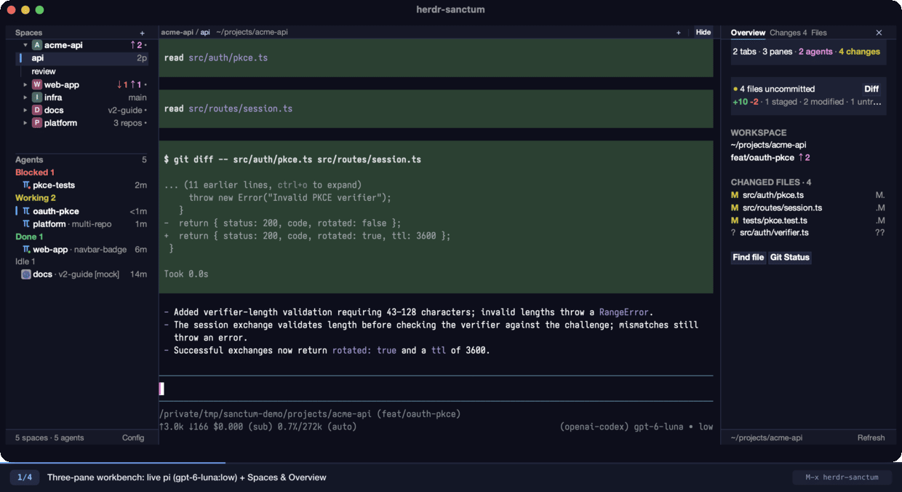
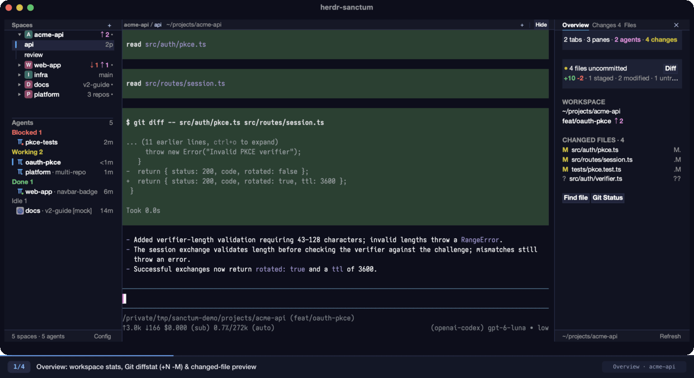
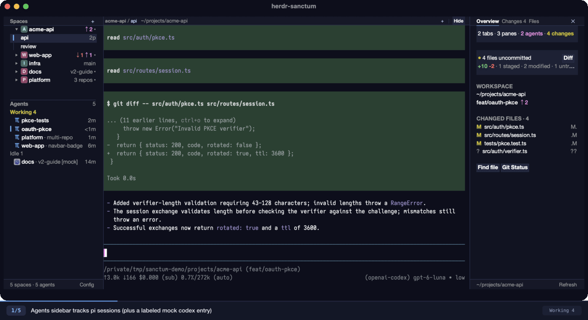
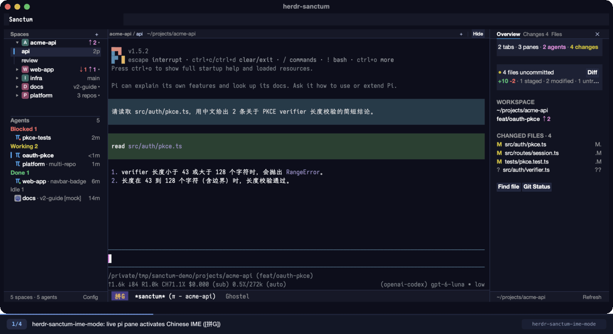

# herdr-sanctum

A native Emacs multi-agent workbench UI for [Herdr](https://github.com/herdr-dev/herdr), built around a three-pane layout.

<picture>
  <source media="(prefers-color-scheme: dark)" srcset="docs/demos/workbench-dark.gif">
  <source media="(prefers-color-scheme: light)" srcset="docs/demos/workbench-light.gif">
  
</picture>

> All demos below are captured live from Emacs (`modus-vivendi-tinted` / `modus-operandi-tinted` styled with [`examples/sanctum-config.el`](examples/sanctum-config.el)) running real `ghostel` and real `pi` sessions over temporary Git repositories. Herdr RPC events and the secondary `codex` entry labeled `[mock]` are mocked.

- **Left sidebar (`*sanctum-spaces*`)**: unified top header bar (`Spaces` + `+`), flat Herdr spaces with inline SVG monograms, combined async Git ahead/behind/dirty indicators, focused-space auto-expanding tab tree (`'focused` default, manual toggle via `TAB` or chevron click), and a compact **Agents** section flowing directly beneath Spaces grouped by `Blocked` / `Working` / `Done` / `Idle` with brand icons and elapsed durations.
- **Center terminal (`*sanctum*`)**: hosts `herdr` through a pluggable terminal backend (built-in `ghostel`, `vterm`, and `eat`), sharing the unified top header-line with breadcrumbs and auto-converging right-side controls (view pills when the drawer is closed, collapsing to a single `Hide` button while open).
- **Right context drawer (`*sanctum-drawer*`)**: compact toggleable panel (`34`-column default) with a unified single-row top `header-line` view switcher aligned across all three panes, backed by a declarative view registry shipping with **Overview** (Git status card with `+N -M` diffstat, compact `Tabs / Panes / Agents / Changes` workspace statistics card, workspace context, automatic shallow sub-repository aggregation for multi-repo workspaces, and changed-file preview), **Changes**, and **Files** views.
- **Seamless navigation & focus**: move across Herdr panes and adjacent Emacs side windows with the same directional commands, fuzzy-jump across attention agents and tabs (`herdr-sanctum-jump`), and see a quiet global attention badge (`◆N ✓N`) whenever the sidebar is hidden.

## Feature Demos

### Context Drawer & Multi-Repo Git

Switch between **Overview**, **Changes**, and **Files** inside `*sanctum-drawer*`, with automatic shallow sub-repository aggregation when a workspace directory contains multiple Git repositories:

<picture>
  <source media="(prefers-color-scheme: dark)" srcset="docs/demos/drawer-views-dark.gif">
  <source media="(prefers-color-scheme: light)" srcset="docs/demos/drawer-views-light.gif">
  
</picture>

### Agent Lifecycle, Global Badge & Fuzzy Jump

Track live `Working` / `Blocked` / `Done` transitions over `herdr.sock`, surface a quiet global attention badge (`◆N ✓N`) whenever the sidebar is hidden, and jump straight to blocked agents with `M-x herdr-sanctum-jump`:

<picture>
  <source media="(prefers-color-scheme: dark)" srcset="docs/demos/agents-jump-dark.gif">
  <source media="(prefers-color-scheme: light)" srcset="docs/demos/agents-jump-light.gif">
  
</picture>

## Requirements

- Emacs 30.1 or later
- [`herdr`](https://github.com/herdr-dev/herdr) in `exec-path`
- A terminal emulator backend (built-in `'ghostel` default via [`ghostel`](https://github.com/dalanicolai/ghostel), `'vterm`, or `'eat`, or register your own via `herdr-sanctum-register-terminal-backend`)
- Optional: `magit`, `nerd-icons`, `modus-themes` / `ef-themes` (all soft dependencies with built-in fallbacks)

## Installation

### `use-package` + `package-vc` (Emacs 30.1+)

```elisp
(use-package herdr-sanctum
  :vc (:url "https://github.com/oatiz/herdr-sanctum")
  :bind (("C-c h" . herdr-sanctum)
         ("C-c H" . herdr-sanctum-sidebar-toggle)
         ("C-c D" . herdr-sanctum-drawer-toggle)
         ("C-c J" . herdr-sanctum-jump)))
```

Or bind the opt-in prefix keymap:

```elisp
(keymap-global-set "C-c s" herdr-sanctum-command-map)
```

### Recommended `~/.config/herdr/config.toml`

To avoid duplicate sidebars or tab bars inside Emacs, hide Herdr's built-in chrome and inherit the terminal palette:

```toml
[theme]
name = "terminal"

[ui]
sidebar_start_collapsed = true
sidebar_collapsed_mode = "hidden"
hide_tab_bar = true
pane_outer_borders = false
redraw_on_focus_gained = false
```

Run `M-x herdr-sanctum-doctor` inside Emacs to verify your setup.

## Commands & Navigation

All navigation and layout commands operate on Herdr panes/tabs while inside `*sanctum*` and fall back seamlessly to Emacs windows/tabs elsewhere:

- **Directional navigation**: `herdr-sanctum-nav-left`, `herdr-sanctum-nav-down`, `herdr-sanctum-nav-up`, `herdr-sanctum-nav-right` (crosses from Herdr edge panes into adjacent Emacs side windows).
- **Splits, zoom & close (DWIM)**: `herdr-sanctum-split-right`, `herdr-sanctum-split-down`, `herdr-sanctum-zoom-or-maximize`, `herdr-sanctum-close-dwim`.
- **Tabs & agents**: `herdr-sanctum-prev-tab`, `herdr-sanctum-next-tab`, `herdr-sanctum-new-tab-dwim`, `herdr-sanctum-prev-agent`, `herdr-sanctum-next-agent`, `herdr-sanctum-prev-attention-agent`, `herdr-sanctum-next-attention-agent`. Set `herdr-sanctum-jump-include-idle-agents` to control whether idle agents appear in `herdr-sanctum-jump`.
- **Workbench & diagnostics**: `herdr-sanctum`, `herdr-sanctum-sidebar-toggle`, `herdr-sanctum-drawer-toggle`, `herdr-sanctum-jump`, `herdr-sanctum-reset-layout`, `herdr-sanctum-refresh-state`, `herdr-sanctum-disconnect`, `herdr-sanctum-apply-theme`, `herdr-sanctum-doctor`.
- **Prefix keymap & `repeat-mode`**: `herdr-sanctum-command-map` binds `s` open/toggle, `b` sidebar, `d` drawer, `o` open drawer view, `f` focus terminal, `r` reset layout, `j` jump, `n`/`p` next/prev agent, `a`/`A` next/prev attention agent, `[`/`]` prev/next tab, `t` new tab, `v`/`h` split right/down, `z` zoom/maximize, `x` close DWIM, `g` refresh, `q` disconnect, `?` doctor, with built-in Emacs `repeat-mode` support (`n`/`p`/`a`/`A`/`[`/`]`) for rapid agent and tab cycling.
- **Panel keys & Evil compatibility**: in `*sanctum-spaces*`, click space chevrons (`▸`/`▾`) or press `TAB`/`h`/`l` to fold and `,` to open Herdr's config; in `*sanctum-drawer*`, `d` diffs the file at point (or repo), `D` opens the directory outside Sanctum, and `.` toggles dotfiles (`?` shows all keys in either panel). Under Evil, `herdr-sanctum-evil-initial-state` defaults to `'emacs` for sidebar/drawer so Sanctum's built-in keys work immediately.

## Customization & Extensibility

### Layout, Sidebar, Drawer & Git

- **Host & layout**: `herdr-sanctum-display-mode` (`'tab` default dedicated `tab-bar` tab, `'current`, `'frame`, or a custom 0-arg function for `tabspaces`/`activities`/`persp-mode`), `herdr-sanctum-min-terminal-width` (default `40`), `herdr-sanctum-hide-scroll-bars` (default `t`, local to Sanctum windows), `herdr-sanctum-header-line-enable`, `herdr-sanctum-status-badge-enable`.
- **Sidebar (`*sanctum-spaces*`)**: `herdr-sanctum-sidebar-side`, `herdr-sanctum-sidebar-width`, `herdr-sanctum-sidebar-default-open`, `herdr-sanctum-sidebar-sections` (default `'(spaces agents)`), `herdr-sanctum-sidebar-default-expand` (default `'focused`), `herdr-sanctum-sidebar-show-idle-agents` (default `t`), `herdr-sanctum-sidebar-space-meta-function` (custom `(WS GIT-INFO MAX-PX)` right-side metadata formatter), `herdr-sanctum-sidebar-footer-action` (`nil` default `Config` button, `'none`, or `(LABEL . ACTION)`).
- **Drawer (`*sanctum-drawer*`)**: `herdr-sanctum-drawer-side`, `herdr-sanctum-drawer-width` (default `34`), `herdr-sanctum-drawer-default-open`, `herdr-sanctum-drawer-default-view` (default `nil`, first enabled view), `herdr-sanctum-drawer-enabled-views`, `herdr-sanctum-drawer-files-show-dotfiles` (default `t`, toggled with `.`), `herdr-sanctum-drawer-files-ignore` (default `'(".git" ".DS_Store")`; accepts exact names, `(regexp . PATTERN)`, or predicate functions).
- **Async Git**: polls via `git --no-optional-locks` so background updates never contend with concurrent Git commands. Configure with `herdr-sanctum-git-enable` (default `t`), `herdr-sanctum-git-exclude-dirs` (directory prefixes, `(regexp . PATTERN)`, or predicates), `herdr-sanctum-git-skip-remote` (default `t`), `herdr-sanctum-git-command-timeout` (default `15.0`s), and multi-repo subrepo discovery (`herdr-sanctum-git-subrepo-max-depth` default `1`, `herdr-sanctum-git-subrepo-max-count` default `12`, `herdr-sanctum-git-subrepo-exclude-dirs` default `'("~/" "/")`).

### Terminal Backends

Built-in backends are `'ghostel` (default), `'vterm`, and `'eat` (selected via `herdr-sanctum-terminal-backend`). Set `herdr-sanctum-terminal-mode-line-format` (default `nil` hidden; `'default` or a custom spec) to show a mode-line in `*sanctum*`. Register custom backends with `herdr-sanctum-register-terminal-backend`:

```elisp
(herdr-sanctum-register-terminal-backend
 'my-term
 :start (lambda (buffer program args) ...)
 :live-p (lambda (buffer) ...)
 :setup (lambda (buffer) ...)         ; optional
 :resize (lambda (window) ...)        ; optional
 :mode-banner (lambda (buffer) ...)   ; optional
 :available-p (lambda () ...))        ; optional

(setopt herdr-sanctum-terminal-backend 'my-term)
```

### Custom Drawer Views

Add your own view to both `*sanctum-drawer*` and `*sanctum*`'s top header bar (and remove views with `herdr-sanctum-unregister-drawer-view`):

```elisp
(herdr-sanctum-register-drawer-view
 'notes
 :label "Notes"
 :render-fn (lambda (ctx)
              (insert "Project dir: " (or (plist-get ctx :dir) "none") "\n"))
 :action-fn (lambda (action value) ...)  ; or (action value ctx)
 :keymap my-notes-view-map               ; optional view-local keymap
 :refresh-fn (lambda (ctx) ...)          ; optional `g' refresh hook
 :render-key-fn (lambda (ctx) ...)       ; optional scroll-stability key
 :tick-refresh nil)                      ; optional periodic tick refresh

(add-to-list 'herdr-sanctum-drawer-enabled-views 'notes t)
```

### Theme, Surface & External Actions

- See [`examples/sanctum-config.el`](examples/sanctum-config.el) for a complete, copy-ready UI setup (`herdr-sanctum-panel-surface-blend`, `modus-themes` overrides, `spacious-padding`, `vertico`, `nerd-icons`, and pill-styled mode-line).
- Adapts automatically to `modus-themes`, `ef-themes`, and arbitrary light/dark themes via `herdr-sanctum-palette-function` and `herdr-sanctum-palette-overrides` (`(TOKEN . COLOR)` alist). Customize side-panel visuals with `herdr-sanctum-panel-surface-blend` (e.g. `0.58`), `herdr-sanctum-panel-line-spacing` (default `0.22`), and `herdr-sanctum-panel-fringe-width` (default `10` px); run `M-x herdr-sanctum-apply-theme` interactively to force-reapply chrome faces.
- `herdr-sanctum-agent-icon-style`: `'svg-files` (bundled icons in `assets/agents/` with automatic 1-letter SVG monogram fallback) or `'unicode`; customize status symbols with `herdr-sanctum-status-glyphs`.
- External openers: `herdr-sanctum-open-file-function`, `herdr-sanctum-open-directory-function` (`D`), `herdr-sanctum-diff-function`, `herdr-sanctum-file-diff-function`, `herdr-sanctum-git-status-function`, `herdr-sanctum-project-find-file-function`, `herdr-sanctum-open-outside-function`.

### Public Event Hooks

Build notifications, automation, or custom status indicators on top of the socket bridge:

- `herdr-sanctum-snapshot-hook` `(snapshot)`
- `herdr-sanctum-focus-change-hook` `(dir pane-id workspace-id tab-id)`
- `herdr-sanctum-agent-status-change-hook` `(agent old-status new-status)`
- `herdr-sanctum-event-hook` `(kind data)`
- `herdr-sanctum-disconnect-hook` `()`

## Optional Companion Modules

<picture>
  <source media="(prefers-color-scheme: dark)" srcset="docs/demos/companions-dark.gif">
  <source media="(prefers-color-scheme: light)" srcset="docs/demos/companions-light.gif">
  
</picture>

### Per-pane Input Method Sync (`herdr-sanctum-ime`)

Automatically activates your Emacs input method (such as `rime`, `pyim`, or any `default-input-method`) on coding-agent panes, switches to ASCII on shell panes, remembers manual toggles per pane, and resets on agent transitions:

```elisp
(require 'herdr-sanctum-ime)
(herdr-sanctum-ime-mode 1)
```

Customize per-pane rules with `herdr-sanctum-ime-default-function` (`(PANE SNAPSHOT)` returning `'on`/`'off`, an input method name string, or `'default`), or integrate external OS IME controllers (`sis`, `macism`, `fcitx5-remote`) via `herdr-sanctum-ime-activate-function` and `herdr-sanctum-ime-deactivate-function` (plus optional `herdr-sanctum-ime-active-p-function`).

### Declarative Tab Routing (`herdr-sanctum-tab-routing`)

Keep `*sanctum*` dedicated and unsplit by routing buffers opened from `*sanctum*`, `*sanctum-spaces*`, and `*sanctum-drawer*` into designated `tab-bar` tabs (updating `herdr-sanctum-tab-routing-rules` takes effect live without restarting the mode):

```elisp
(require 'herdr-sanctum-tab-routing)
(setopt herdr-sanctum-tab-routing-rules
        '(("Atlas" :modes (org-agenda-mode))
          ("Bench" :commands (eshell) :modes (proced-mode))
          ("Folio" :file t :commands (consult-buffer)
                   :modes (diff-mode vc-dir-mode magit-mode dired-mode grep-mode rg-mode))))
(herdr-sanctum-tab-routing-mode 1)
```

Each rule's `TAB-NAME` may be a static string or a 1-arg `(BUFFER)` function returning a dynamic tab name (or `nil` to continue matching). Unmatched buffers opened from the Sanctum tab route via `herdr-sanctum-tab-routing-fallback-tab` (default `'recent`), while popup buffers can be exempted with `herdr-sanctum-tab-routing-exclude-rules`. Commands that display their buffer before activating its major mode (such as `eshell`) should be matched via `:commands` or `:name-regexp` rather than `:modes`.

## Development & Tests

```bash
make compile
make test
```

## Attribution & License

- Elisp source code is licensed under **GPL-3.0-or-later** (see [LICENSE](LICENSE)).
- Static agent SVG icons in `assets/agents/` are sourced from [`@lobehub/icons`](https://github.com/lobehub/lobe-hub/tree/main/packages/icons-static-svg) (MIT License) and remain subject to their respective owners' trademarks. Set `herdr-sanctum-agent-icon-style` to `'unicode` for a zero-asset setup.
